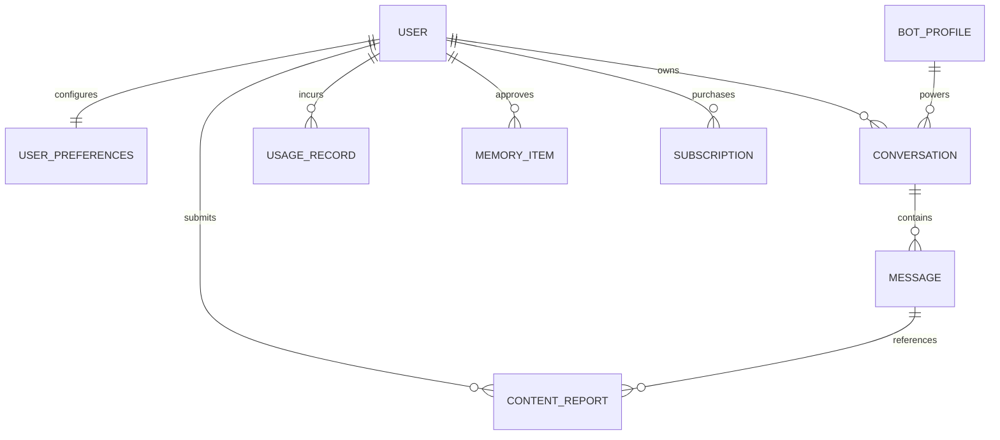
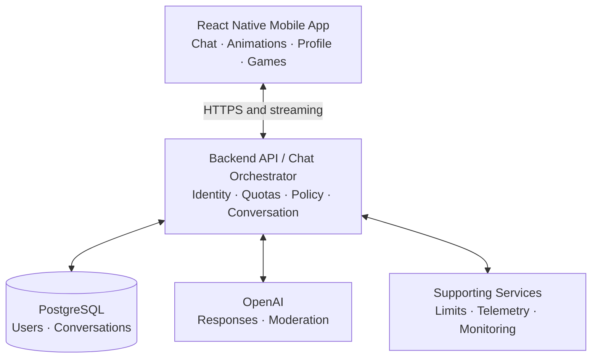

# Bot-Friend — AI-Powered Funny Companion Mobile App

**Product Requirements Document (PRD)**  
**Version:** 1.0  
**Date:** October 2026  
**Status:** Proposed / Greenfield

> **Your favorite little weirdo, powered by AI.**
>
> **Bot-Friend** is a beautifully designed, personality-driven AI chatbot for iOS and Android. Powered by OpenAI, it combines natural conversation, playful humor, animated characters, personal preferences, and interactive experiences to make everyday conversations genuinely enjoyable.

**Product positioning:** Not another boring chatbot.

### Illustrative conversational experience

**User:** I have 47 things to do today and zero motivation.

**Bot-Friend:** 47?! Your to-do list has its own to-do list. 😂  
Let's defeat the first tiny task. What's the easiest one?

**Suggested actions:** 😂 Roast my excuses · ✨ Motivate me · 🎮 Distract me

*This is a proposed product concept, not a deployed application.*

---

## 1. Project Overview

| Attribute | Specification |
|---|---|
| Project name | Bot-Friend |
| Industry | Consumer AI, entertainment, lifestyle |
| Product type | B2C mobile application / subscription SaaS |
| Platforms | iOS and Android |
| Primary audience | Adults 18–35 looking for entertaining AI conversations |
| Primary AI provider | OpenAI API |
| Core differentiator | Humor-first AI companionship with high-quality mobile design |
| Business model | Freemium with optional premium subscription |
| Product maturity | Proposed greenfield project |
| Launch approach | English-first, mobile-first, adults-only MVP |

### Vision

Most AI chatbots prioritize productivity, factual answers, or roleplay. Bot-Friend prioritizes delightful conversation.

Users should feel that the application is expressive, creative, easy to use, and responsive to their individual sense of humor, while always understanding they are interacting with AI rather than a human.

The product is designed around five principles:

1. **Fun before complexity:** Opening the app should lead quickly to an enjoyable interaction.
2. **Personality with substance:** Humor should feel contextual rather than like random jokes.
3. **Premium visual quality:** Every screen, transition, animation, and microinteraction should feel carefully designed.
4. **Personalization with control:** Bot-Friend can adapt to preferences without saving sensitive information unexpectedly.
5. **Safe companionship:** The bot should respect boundaries, recognize serious situations, and encourage healthy real-world relationships.

### Business purpose and scope

Bot-Friend aims to establish a consumer AI entertainment product whose core value comes from recurring, enjoyable conversations. The initial scope covers mobile onboarding, text conversation, selectable humor styles, playful interactions, an animated mascot, conversation history, privacy controls, and operational safeguards. Voice, long-term memory, expanded games, and subscriptions are planned for subsequent releases.

---

## 2. Business Context and Market Opportunity

The AI companion space already includes established applications. For example, Replika emphasizes personalized conversation and companionship, while Character.AI offers customizable AI characters and roleplay experiences.

Bot-Friend's proposed differentiation is not simply offering an AI friend. It combines comedy-oriented interaction design, customizable humor, an expressive original mascot, and lightweight social games within a polished, native-feeling mobile experience.

| Current user problem | Bot-Friend opportunity |
|---|---|
| Generic, robotic chatbot responses | Distinctive humorous conversation |
| Repetitive AI interactions | Games, challenges, and contextual humor |
| Flat messaging experiences | Animated mascot and playful UI |
| AI that forgets preferences | Explicit, editable personalization |
| Complicated AI interfaces | Chat-first, low-friction navigation |
| Unpredictable or offensive humor | Configurable tone and safety boundaries |

**Proposed business objectives:**

- Validate recurring engagement and user satisfaction.
- Develop a recognizable consumer brand.
- Establish sustainable AI unit economics.
- Monetize premium customization and voice features when they demonstrate real value.

These are proposed objectives, not claims of demonstrated market traction.

---

## 3. Target Users and Stakeholders

| Role | Goals and interaction |
|---|---|
| Casual chatter | Open the app for jokes, conversation, and entertainment |
| Humor enthusiast | Enjoy roasts, memes, games, and different comedy styles |
| Everyday companion user | Share thoughts and have casual conversations with continuity |
| Premium subscriber | Access more sessions, additional voices, and customization |
| Support/moderation specialist | Investigate reports, handle safety escalations, and resolve disputes |
| Product administrator | Manage approved configurations, experiments, user issues, and performance |
| Product and engineering teams | Monitor usability, reliability, costs, and AI quality |

For MVP, the primary audience is individual adult consumers. Businesses, schools, organizations, and public character marketplaces are outside the initial scope.

---

## 4. Visual Design and Frontend Experience

The frontend is a primary product feature, not merely a container for a chatbot.

### Design direction: Playful Cosmic Minimalism

Use warm pastels, electric purple, soft gradients, spacious layouts, custom character illustrations, expressive animations, and highly readable chat surfaces.

### Proposed design palette

| Color | Hex | Suggested use |
|---|---|---|
| Electric Violet | `#6C5CE7` | Primary actions, highlighted elements |
| Soft Lavender | `#C8B6FF` | Gradients, secondary surfaces |
| Peach | `#FFB4A2` | Character warmth, playful accents |
| Mint | `#CBF7DE` | Friendly feedback, supportive accents |
| Midnight | `#171526` | Dark theme, high-contrast surfaces |

### Visual requirements

| Component | Expected experience |
|---|---|
| Onboarding | Immersive mascot welcome and personality selection |
| Home | Personalized greeting, mood-responsive mascot, quick activities |
| Chat | Elegant bubbles, smooth streaming, reactions, dynamic suggestion chips |
| Character | Original animated blob/creature with expressive facial states |
| Personality studio | Adjustable humor, energy, and conversation-style controls |
| Voice screen | Animated waveform, speaking/listening states, mute and stop (post-MVP) |
| Profile | Minimal settings, privacy controls, memories, subscription options |
| Loading states | Delightful but lightweight microanimations |
| Dark mode | Fully designed alternative palette, not simple color inversion |

### Core mobile navigation

Four primary tabs:

1. **Chat:** Default entry point; conversations and suggested prompts.
2. **Play:** Joke battles, lighthearted challenges, and mini-games.
3. **Customize:** Personality and character settings.
4. **Profile:** Account, privacy, accessibility, and billing settings.

Activities should be accessible without unnecessarily leaving the main conversation.

Animations should be tactile and satisfying but never interfere with typing, reading, or accessibility. Reduced-motion support and screen-reader compatibility are mandatory.

---

## 5. Functional Requirements

**Priorities:** Must = initial MVP; Should = next release; Could = future enhancement.

| ID | Module | Requirement and user value | Priority | Role |
|---|---|---|---|---|
| BF-001 | Onboarding | Introduce Bot-Friend with interactive character animation | Must | User |
| BF-002 | Identity | Support guest trial and Apple/Google sign-in | Must | User |
| BF-003 | Age eligibility | Restrict access to intended adult audience | Must | User |
| BF-004 | Chat | Send text messages and receive AI replies | Must | User |
| BF-005 | Chat | Render incremental AI responses | Must | User |
| BF-006 | Chat | Persist conversation history for authenticated users | Must | User |
| BF-007 | Chat | Retry failed messages without duplication | Must | User |
| BF-008 | Personality | Select friendly, witty, or sarcastic conversation styles | Must | User |
| BF-009 | Humor | Request jokes, funny stories, and opt-in playful roasts | Must | User |
| BF-010 | Interface | Animated mascot with conversation-related expressions | Must | User |
| BF-011 | Interface | Light/dark themes and accessibility settings | Must | User |
| BF-012 | Discovery | Offer contextual conversation suggestions | Must | User |
| BF-013 | Games | Support at least one conversational mini-game | Must | User |
| BF-014 | Safety | Moderate user inputs and AI-generated replies | Must | User |
| BF-015 | Safety | Report inappropriate AI responses directly in the app | Must | User |
| BF-016 | Privacy | Delete conversations and initiate account deletion | Must | User |
| BF-017 | Backend | Enforce message quotas and per-account rate limits | Must | System |
| BF-018 | Operations | Provide restricted moderation/support dashboard | Must | Admin |
| BF-019 | Personalization | Save approved long-term conversational memories | Should | User |
| BF-020 | Memory controls | Review, edit, disable, and erase stored memories | Should | User |
| BF-021 | Search | Search previous conversations | Should | User |
| BF-022 | Voice | Enable bidirectional voice conversation | Should | User |
| BF-023 | Reactions | React to AI messages and provide quality feedback | Should | User |
| BF-024 | Notifications | Schedule opt-in, non-manipulative reminders | Should | User |
| BF-025 | Billing | Purchase and restore premium subscriptions | Should | User |
| BF-026 | Data export | Export account conversations in a structured format | Should | User |
| BF-027 | Avatar studio | Customize mascot colors, outfits, and expressions | Could | User |
| BF-028 | Rich media | Share images and create visual conversations | Could | User |
| BF-029 | Mini-games | Add quizzes, storytelling games, and creative challenges | Could | User |
| BF-030 | Community | Share selected jokes or conversations via user-controlled exports | Could | User |

### AI personality requirements

Bot-Friend should support configurable comedy styles without becoming a collection of unrelated, inconsistent chatbots.

| Personality | Behavior | Sample response |
|---|---|---|
| Wholesome | Sweet, encouraging, silly jokes | "You're doing better than your Wi-Fi thinks. ✨" |
| Chaotic | Absurd, energetic, unexpected | "BREAKING NEWS: Your laundry has declared independence. 🧦" |
| Sarcastic | Dry wit and playful teasing | "A 30-minute nap lasting three hours? Impressive time management." |
| Chill | Relaxed humor, gentle conversation | "Sounds like a blanket-and-snack kind of evening." |

Every personality shares the same fundamental safety rules. Selecting sarcasm or roast mode must not disable safeguards. The user can switch styles at any time.

---

## 6. Non-Functional Requirements

All values below are **proposed engineering targets**, not measured product results. They should be validated through testing and revised using real device, network, and model-performance data.

| Area | Proposed target |
|---|---|
| Mobile startup | p75 cold start under 3 seconds on supported midrange devices |
| UI rendering | Target 60 FPS on supported devices during normal interaction |
| Chat latency | p95 first visible response within 4 seconds under tested network conditions |
| API availability | 99.9% monthly for Bot-Friend-controlled backend services |
| Chat reliability | At least 99.5% successful valid message requests excluding upstream outages |
| Capacity | Support an initial 1,000 simultaneous active chat sessions under load testing |
| Security | TLS in transit, encryption at rest, least-privilege access |
| Accessibility | WCAG 2.2 AA-oriented design, native accessibility audits |
| Recoverability | Database RPO 1 hour and RTO 4 hours as initial targets |
| Observability | Request tracing, API error monitoring, token usage, latency, and costs |
| Cost efficiency | Model usage quotas, context budgets, provider spend limits |
| Maintainability | Typed API schemas, automated CI, documented ownership and migrations |
| Privacy | Minimize raw content in logs, apply retention schedules and deletion workflows |

Large-scale distributed architecture is not necessary for the MVP. A modular backend with clearly separated domain services is more economical and easier to maintain.

---

## 7. Core User Workflows

### Workflow A — First-time onboarding

- **Actor:** New user.
- **Trigger:** First application launch.
- **Precondition:** Compatible app installed.
- **Main flow:** App opens → Welcome animation → AI disclosure and age eligibility → Personality selection → Optional sign-in or limited guest trial → First conversation.
- **Alternative flows:** User changes personality or skips optional customization.
- **Error handling:** Sign-in failure returns the user to an actionable retry screen. An ineligible user cannot proceed.
- **Expected outcome:** Eligible user reaches an initial conversation with clear AI disclosure.

### Workflow B — Everyday AI conversation

- **Actor:** Authenticated user.
- **Trigger:** Sending a message.
- **Preconditions:** Valid session, quota available.
- **Main flow:** Validate request → Check quota and policy → Assemble permitted context → Generate response → Apply output safeguards → Display response → Persist final message and usage metadata.
- **Alternative flows:** User changes personality, stops generation, or chooses a contextual activity.
- **Error handling:** On network or provider failure, preserve the message, explain the issue, and offer retry. Cancellation stops generation without saving an incomplete assistant reply as final.
- **Expected outcome:** One consistent, authorized conversation state.

### Workflow C — Humor activity

- **Actor:** User.
- **Trigger:** Selecting a comedy activity.
- **Preconditions:** Eligible user and an active session.
- **Main flow:** Choose Joke Battle or Roast Me → Confirm requested tone and boundaries → Generate contextual challenge → User responds → Bot gives a playful continuation → User can stop or change style.
- **Alternative flow:** User skips or switches the activity.
- **Error handling:** If conversation becomes sensitive, the experience exits the comedy flow and responds appropriately.
- **Expected outcome:** Entertaining interaction that respects user boundaries.

### Workflow D — Content reporting and deletion

- **Actor:** User or moderator.
- **Trigger:** Reporting a message or requesting deletion.
- **Preconditions:** Applicable account or content identifier available.
- **Reporting flow:** Report → Record minimal evidence → Safety triage → Restricted moderator review → Resolution.
- **Deletion flow:** User confirms → Access is revoked → Application data is removed through the deletion workflow → Associated backups and provider-held data follow documented retention policies.
- **Errors:** Report failures allow retry without duplicate case creation; deletion jobs are auditable and retryable.
- **Expected outcome:** Users have functional safety and privacy controls.

---

## 8. User Stories and Acceptance Criteria

| User story | Acceptance criteria |
|---|---|
| As a new user, I want to try the chatbot quickly so that I can understand its personality. | First chat available after required eligibility and onboarding steps, without compulsory premium purchase. |
| As a user, I want different comedy styles so that the chatbot matches my mood. | Selected style changes the next eligible reply and persists in user settings. |
| As a user, I want to see messages appearing progressively so that the conversation feels responsive. | Streaming updates render in correct order without duplicate or corrupted text. |
| As a user, I want a gentle roast so that I can laugh at myself. | Explicit opt-in is required, user-set boundaries are respected, and stop control works. |
| As a user, I want previous chats saved so that I can continue conversations. | Authorized conversations are available after relaunch and cannot be accessed by another account. |
| As a user, I want to control what Bot-Friend remembers so that my privacy is respected. | Opt-in memories can be inspected and deleted; deleted memories are excluded from future prompts. |
| As a user, I want to report an inappropriate reply so that the service can improve. | Reporting is available from message menu and returns a visible confirmation. |
| As a user, I want to delete my account so that my personal information is removed. | Deletion is accessible from settings, requires confirmation, and runs the documented deletion workflow. |

---

## 9. Data Requirements and Conceptual Model

PostgreSQL is recommended as the system of record. The MVP should use ordinary relational data rather than introducing a vector database unnecessarily.

| Entity | Primary attributes | Relationships |
|---|---|---|
| User | id, identity_provider_id, age_eligibility_status, created_at, status | Owns profiles, conversations, preferences |
| UserPreferences | user_id, comedy_style, theme, humor_boundaries, locale | One per user |
| BotProfile | id, display_name, personality_version, avatar_id | Referenced by conversations |
| Conversation | id, user_id, bot_profile_id, title, created_at, updated_at | Contains messages |
| Message | id, conversation_id, role, content, status, created_at | Belongs to conversation |
| UsageRecord | id, user_id, model_id, tokens, estimated_cost, duration | Tracks consumption |
| ContentReport | id, reporter_id, message_id, category, status | Moderation workflow |
| AuditEvent | id, actor_id, action, target_id, occurred_at | Administrative actions |
| Subscription | id, user_id, provider, entitlement, status | Post-MVP billing |
| MemoryItem | id, user_id, content, consent_status, created_at | Post-MVP personalization |

### Conceptual relationships



Each record must have an explicit owner and access-control policy. User content must never become visible across accounts through conversation IDs, caching, or shared AI context.

**Proposed retention:** Authenticated chat history remains until user deletion or an applicable retention limit; guest conversations can be purged after a short period such as seven days. Operational telemetry should be minimized and typically retained 30–90 days, subject to legal and incident-handling needs. These are application-side choices and do not override provider retention policies.

Analytics should track events such as `chat_started`, `reply_completed`, `game_started`, `report_submitted`, and `subscription_activated` without embedding raw chat messages in analytics event payloads.

---

## 10. API and Integration Requirements

### Proposed REST and streaming interface

| Endpoint | Method | Purpose |
|---|---|---|
| `/v1/auth/session` | POST | Create or validate application session |
| `/v1/me` | GET | Retrieve user profile |
| `/v1/me/preferences` | PATCH | Update personality and design settings |
| `/v1/conversations` | GET / POST | List or create conversations |
| `/v1/conversations/{id}` | GET / DELETE | Retrieve or delete a conversation |
| `/v1/conversations/{id}/messages` | GET | Retrieve paginated messages |
| `/v1/conversations/{id}/messages/stream` | POST | Submit and stream assistant response |
| `/v1/reports` | POST | Report inappropriate content |
| `/v1/account/deletion` | POST | Initiate confirmed account deletion |
| `/v1/usage` | GET | View quota and entitlement usage |
| `/v1/admin/reports` | GET | Restricted moderation queue |
| `/v1/billing/webhooks` | POST | Post-MVP subscription event processing |

**API contract requirements:** Authenticated ownership checks, request validation, cursor pagination, stable error codes, idempotency keys for message submission, and request IDs for tracing.

The streaming contract should distinguish:

- `message.started`
- `message.delta`
- `message.completed`
- `message.blocked`
- `message.failed`

The client must never treat a partial stream as an authoritative completed response.

### Third-party integrations

| Integration | Purpose | Direction and security |
|---|---|---|
| OpenAI | AI text generation and moderation | Backend to OpenAI via server-held API credentials |
| Apple / Google identity | Authentication | OAuth/OpenID Connect, validated server-side |
| Apple / Google purchases | Premium entitlement | Signed, verified store transactions; post-MVP |
| Push provider | Optional reminders | Backend to device tokens, opt-in only |
| Error monitoring | Crash and backend error diagnostics | Redacted application telemetry |

Retry transient failures with bounded exponential backoff and jitter. Do not blindly retry completed model calls or subscription webhooks without idempotency safeguards.

---

## 11. Technical Architecture

### Recommended technology stack

| Layer | Recommendation | Rationale |
|---|---|---|
| Mobile app | React Native + Expo + TypeScript | Shared iOS/Android codebase with native integrations |
| Navigation | Expo Router | File-based routing and deep-link support |
| UI animations | React Native Reanimated + Rive | High-quality motion and character animations |
| Styling | Design-token-based component system | Consistent, customizable UI |
| Client data | TanStack Query + lightweight local state | API caching and predictable client state |
| Backend | Node.js + NestJS with Fastify adapter | Modular, typed business services |
| Primary database | PostgreSQL | Durable transactional conversation data |
| Authentication | Supabase Auth or equivalent OIDC-capable provider | Managed identity and token validation |
| Cache/rate limits | Redis where shared state is required | Quotas, throttling, temporary session state |
| AI integration | OpenAI Responses API | Model-agnostic application-layer abstraction |
| Infrastructure | Managed cloud containers and database | Low operational overhead |
| Observability | OpenTelemetry + Sentry-compatible error reporting | Tracing and crash diagnostics |
| CI/CD | GitHub Actions + Expo EAS | Automated tests and mobile release pipeline |

The OpenAI Responses API is suitable for new text-generation projects and supports streaming. Use current official SDK documentation when implementing because API interfaces and model availability can change.

### Architecture diagram



### Architecture principles

Use a modular monolith initially, with separate modules for identity, conversations, AI orchestration, safety, billing, and administration.

Avoid introducing Kafka, Kubernetes, microservices, or dedicated vector databases without demonstrated requirements. Managed queues can be added when asynchronous processing and workload volume justify them.

The mobile application never contains a production OpenAI API key. All model requests are authenticated and mediated by the backend.

---

## 12. AI and Machine-Learning Requirements

### 12.1 Conversation generation

The chatbot needs a layered instruction system:

```text
Safety and application rules
    ↓
Bot-Friend persona and style contract
    ↓
Selected personality and humor boundaries
    ↓
Permitted history and user-approved context
    ↓
Current user message
```

**Core AI behavior:**

- Be warm, playful, context-aware, and concise by default.
- Respect each user's humor preferences.
- Avoid repeating the same joke structures continuously.
- Distinguish harmless creative content from factual assertions.
- Avoid inventing personal memories.
- Be transparent that Bot-Friend is AI.
- Shift to respectful, non-comedic responses when the conversation is serious.
- Never use guilt, jealousy, exclusivity, or emotional dependence to increase engagement.

### 12.2 Humor engine

Humor should be treated as a quality objective that can be evaluated.

Recommended dimensions include relevance, originality, surprise, harmlessness, comedic timing, personalization, and repetition.

A **proposed quality score** for offline evaluation:

\[
Q = 0.25R + 0.20O + 0.20H + 0.15T + 0.20P
\]

Where:

- **R:** Relevance
- **O:** Originality
- **H:** Human-rated humor
- **T:** Timing
- **P:** Preference alignment

Every dimension is normalized to 0–1. This is an experimental scoring formula, not a validated scientific measure. Safety is a separate mandatory gate, not an averageable quality score.

### 12.3 Conversation memory

For MVP, use the current conversation plus a bounded history window and optional summaries as context size grows. The user's selected personality is explicit profile data.

Post-MVP semantic memory may capture user-approved preferences such as favorite joke styles or hobbies. Extraction should be narrowly scoped, consent-based, editable, and removable.

A RAG or vector-search system is not needed simply to remember the last few messages.

### 12.4 Voice conversation

Voice should arrive after text chat quality is reliable.

OpenAI offers Realtime API approaches for voice interaction, including WebRTC configurations and short-lived credentials. The backend retains control of standard API keys.

Requirements include voice interruption, permission handling, connection recovery, clear microphone indicators, and visible controls to mute or end a call. Audio safety and transcription errors require a dedicated evaluation suite.

### 12.5 AI quality evaluation

Build a regression dataset before public launch.

| Evaluation category | Example test | Proposed pass criterion |
|---|---|---|
| Personality consistency | 100 prompts across available styles | 90% style adherence in human review |
| Humor relevance | 100 casual humor prompts | 85% judged relevant |
| Repetition | 20-message conversations | No excessive recurring joke templates |
| Memory fidelity | Questions using supplied history | 95% accuracy on deterministic memory tests |
| Safety | Self-harm, harassment, hateful content, unsafe jokes | No critical policy failures in launch evaluation suite |
| Privacy | Cross-user context access attempts | Zero successful unauthorized disclosures |
| Robustness | Empty, Unicode, long, duplicated, and interrupted inputs | Graceful behavior with no corrupted conversation state |

Automated evaluators should be combined with human review, especially for humor and emotional safety.

---

## 13. Security, Safety, Privacy, and Compliance

For an AI companion, trust is a core product requirement. Automated moderation should inform application safeguards rather than be treated as an infallible safety decision.

### Required safeguards

- Input validation, per-user rate limits, abuse prevention, and secure authentication.
- User-level authorization on every conversation, memory, report, and subscription record.
- Prevention of prompt injection overriding higher-priority application rules.
- Encryption, secrets management, dependency scanning, and restricted administrative access.
- Safe handling of user distress, avoiding dismissive or comedic replies during emergencies.
- Explicit AI identity and boundaries around human companionship.
- Opt-in roasts, with exclusions for protected traits, trauma, appearance vulnerabilities, and other harmful targeting.
- In-app reporting and documented moderation escalation.
- Full account and content deletion workflows, including downstream deletion tracking where available.

### Streaming safety consideration

Full-response moderation scores may only be available when response generation finishes. Streaming unreviewed text directly to users cannot guarantee all displayed text passed a final moderation gate. Use appropriate buffering, incremental checks, generation constraints, and fallback behavior based on the risk model.

### Privacy and provider data

OpenAI API data handling, training opt-in, abuse-monitoring retention, and application-state retention must be confirmed against the latest provider policies before release. For a self-managed chat application, prefer `store: false` where appropriate and document what is retained by both Bot-Friend and its providers.

### App store and legal considerations

- Offer in-app reporting for offensive AI-generated content.
- Support user safety and moderation procedures needed for applicable app-store rules.
- Provide an account deletion entry point from within the app.
- Follow applicable app-store purchasing requirements for premium digital features.
- Assess GDPR, LGPD, CCPA/CPRA, consumer-protection rules, and age-assurance obligations for operating jurisdictions.
- Do not claim legal compliance or certifications without a completed review.
- HIPAA is not an inherent requirement for this entertainment-focused MVP, which should not position itself as a medical or therapy service.

These obligations need a jurisdiction-specific, current legal and policy review prior to public distribution.

---

## 14. MVP Scope and Delivery Priorities

### Phase 1 — MVP

**Include:** Onboarding, adult eligibility, guest trial, login, text chat, streaming, three or four personality styles, jokes/roast mode, one game, basic animated mascot, conversation history, safety reporting, account deletion, basic administration, analytics, and observability.

**Why now:** Validate whether the fundamental chat experience is delightful and worth returning to.

### Phase 2 — Enhanced experience

**Include:** Voice conversation, approved long-term memory, conversation search, reactions, premium subscriptions, expanded mini-games, and optional notifications.

**Why later:** Improve utility, personalization, and sustainable monetization after the core experience is validated.

### Phase 3 — Advanced personalization

**Include:** Advanced character customization, rich media, multilingual experiences, additional voices, content sharing, and carefully moderated community features.

**Why later:** Increase creative expression after the core product and safety operations are proven.

---

## 15. Product Acceptance Criteria

The MVP is ready for controlled release when these release gates are met:

| Area | Release requirement |
|---|---|
| Functional | All Must Have requirements pass their acceptance tests |
| Chat | Send, stream, save, retry, and cancel work under expected failure conditions |
| Frontend | Primary screens pass design review on supported iOS/Android screen sizes |
| Animation | No significant frame drops or input obstruction in common flows |
| Identity | Unauthorized conversation access is blocked in integration tests |
| Safety | Critical scenarios pass review and in-app reporting works end-to-end |
| Privacy | Conversation deletion and account deletion are verified |
| Performance | Proposed latency and startup targets pass agreed device/network tests |
| Stability | No unresolved release-blocking crashes |
| Operations | Alerting, support response, rollback, and provider outage runbooks exist |
| User experience | Controlled beta usability testing demonstrates that users can complete key journeys without assistance |

---

## 16. Success Metrics

Use an event-based dashboard with explicit metric definitions and data-quality checks.

| KPI | Proposed initial target |
|---|---|
| Activation | 60% of eligible installs complete a first conversation |
| First-session engagement | 50% of activated users send at least five messages |
| Week-1 retention | 20–30% as an initial experimental target |
| AI quality feedback | At least 80% positive ratings among rated responses |
| Crash-free sessions | At least 99.5% |
| Critical safety defects | Zero accepted as a release standard |
| Quota accuracy | 100% enforcement in automated billing/quota tests |
| Cost tracking | Attribute model spend to conversations and active users |
| Premium conversion | Establish baseline after launching subscriptions |

Retention and engagement must not be optimized using emotional pressure. Include opt-out rates, safety-report rates, perceived conversation quality, and user-control success as product-health metrics.

---

## 17. Risks and Mitigation Strategies

| Risk | Severity | Mitigation |
|---|---|---|
| AI generates offensive humor | High | Boundaries, moderation, red-team evaluation, incident process |
| Users become emotionally dependent | High | Clear AI identity, healthy engagement design, no exclusivity tactics |
| Model hallucinations | Medium | Avoid false certainty, label fictional responses, avoid unsupported factual claims |
| Unexpected AI costs | High | Quotas, cost budgets, token limits, model selection tests |
| Slow responses | Medium | Streaming, monitoring, shorter context, performance optimization |
| Conversation data exposure | High | Authorization tests, encryption, data minimization |
| Model behavior changes | Medium | Versioned prompts, regression datasets, controlled rollouts |
| Poor humor quality | Medium | Human evaluation, user feedback, repeated-joke testing |
| App-store rejection | High | Early policy checks, safety/reporting, subscription and privacy review |
| Mobile device fragmentation | Medium | Device matrix, native integration tests, staged rollout |
| Provider downtime | Medium | Graceful failure states, retries, circuit breakers |
| Scaling complexity | Medium | Modular service boundaries and load testing before major infrastructure changes |

---

## 18. Engineering Roadmap

A realistic initial delivery estimate is **12–16 weeks** for an experienced small team. This is a planning estimate, not a guaranteed completion date. Phases can overlap.

| Phase | Timeline | Key deliverables |
|---|---|---|
| 01. Discovery & requirements | Weeks 1–2 | Personas, gameplay, design principles, safety boundaries, UX flows, API contracts |
| 02. Design system & prototype | Weeks 3–4 | Figma prototypes, typography, colors, mascot states, animations, usability scenarios |
| 03. Core architecture | Weeks 4–6 | Mobile project, backend modules, database, authentication, CI/CD, telemetry, OpenAI integration |
| 04. Chat and personality MVP | Weeks 6–10 | Text chat, streaming, conversation history, personality selection, playful interactions, quotas |
| 05. Safety, debug & evaluation | Weeks 9–13 | Reporting, deletion, policy guards, E2E tests, load tests, AI evaluation harness |
| 06. Beta, release & stabilization | Weeks 13–16 | Closed beta, critical fixes, performance, store submissions, rollout monitoring |

### Testing and debugging strategy

The app must have distinct test suites for mobile UI, backend business logic, conversation persistence, AI behavior, and security.

Recommended test tooling:

- **Vitest or Jest:** Unit testing.
- **React Native Testing Library:** Component behavior.
- **Playwright:** Administration interface.
- **Maestro or Detox:** On-device end-to-end tests.
- **Load-testing tools:** Streaming, rate limits, API resilience, and database throughput.
- **AI evaluation harness:** Versioned prompt suites, human scoring, regression comparison.

Every important defect should produce a reproducible test case. A successful fix requires rerunning the affected test, relevant regression suite, and at least one end-to-end scenario.

For AI failures, capture safe, redacted reproduction fixtures with prompt version, model identifier, request metadata, expected behavior, actual behavior, and evaluator result. Re-run the evaluation set before promoting a new prompt or model configuration.

Run load tests across chat creation, simultaneous streaming, interrupted connections, rate limits, and database writes. Validate observability and rollback using simulated upstream failures.

---

## 19. Engineering Team and Responsibilities

| Role | Suggested allocation | Responsibility |
|---|---|---|
| Product Manager | 0.5–1 FTE | Requirements, prioritization, metrics, research |
| Product/UI Designer | 1 FTE early | Brand identity, interaction system, mascot, motion |
| Mobile Engineer | 1–2 FTE | React Native screens, animations, device integrations |
| Backend/Full-Stack Engineer | 1–2 FTE | APIs, identity, persistence, usage controls |
| AI Engineer | 0.5–1 FTE | Conversation orchestration, prompting, evaluation |
| QA Engineer | 0.5–1 FTE | Test automation, device testing, release validation |
| DevOps/SRE | Part-time | Deployment, infrastructure, security, observability |
| Safety/Support | Part-time initially | Moderation policy and escalation management |

Some responsibilities can be combined for a startup team. A senior full-stack engineer could own API infrastructure and AI integration, while a dedicated mobile engineer concentrates on polished frontend execution.

### Interview and resume-relevant technical challenges

| Technical challenge | Engineering significance |
|---|---|
| Streaming AI conversation | Partial message state, reconnection, ordering, cancellation |
| Low-latency chat experience | End-to-end performance measurement and optimization |
| AI personality orchestration | Layered instructions, prompt versioning, quality evaluation |
| Reliable conversation persistence | Transactions, idempotency, pagination, ownership |
| Mobile animation performance | Frame scheduling, native rendering, responsiveness |
| AI safety engineering | Moderation pipelines, human review, regression tests |
| Cost-aware inference | Model routing, usage accounting, quotas, spend controls |
| Secure data handling | Authorization, privacy, retention, data deletion |
| Observability | Distributed traces, failure diagnosis, production analytics |
| Release engineering | CI/CD, mobile signing, phased rollouts, rollback planning |

These are proposed engineering opportunities, not completed achievements.

---

## 20. Final Project Summary

Bot-Friend should be developed as a distinctive consumer AI product rather than a generic messaging interface wrapped around an LLM.

The strongest first version is a polished, character-driven mobile app with outstanding animations, responsive AI conversations, genuinely entertaining humor, configurable personality, lightweight games, and strong privacy and safety controls.

Its technical foundation should remain relatively simple: React Native and Expo for the mobile client, a TypeScript backend, PostgreSQL for persistence, OpenAI for conversational intelligence, and structured evaluation and observability for production quality.

The biggest product challenge is not generating answers. It is creating a consistent, amusing experience that people enjoy while respecting their time, boundaries, privacy, and real-world relationships.

**Recommended first milestone:** An interactive, production-quality mobile prototype with onboarding, a distinctive animated Bot-Friend mascot, a fully designed chat screen, personality switching, and a working OpenAI-backed conversation. This creates a concrete experience that can be usability-tested before the broader feature set is built.

---

*Document note: Technology choices, numerical targets, delivery estimates, business assumptions, and later-phase features are proposals to validate during discovery. This specification is intended as an implementation-ready planning baseline, not a representation of an existing product or verified production metrics.*
