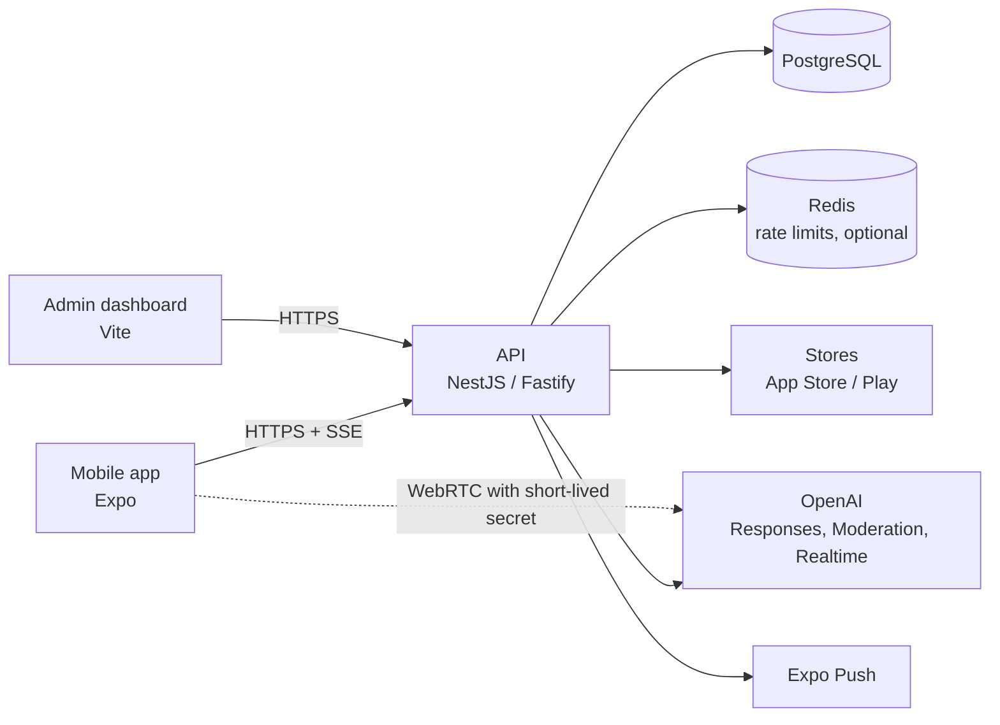

# Bot-Friend engineering guidelines

How Bot-Friend is built, how to work on it, and the rules that keep it fun, safe and private.
Read sections 1–3 before your first change; use the rest as a reference.

Product source of truth: [`Bot-Friend_Product_Requirements.md`](../Bot-Friend_Product_Requirements.md).
Operational procedures: [`RUNBOOKS.md`](./RUNBOOKS.md).

---

## Contents

1. [What we are building](#1-what-we-are-building)
2. [Repository and architecture](#2-repository-and-architecture)
3. [Getting started](#3-getting-started)
4. [Configuration reference](#4-configuration-reference)
5. [Code conventions](#5-code-conventions)
6. [API guidelines](#6-api-guidelines)
7. [The chat turn, end to end](#7-the-chat-turn-end-to-end)
8. [Database and migrations](#8-database-and-migrations)
9. [AI, prompts and personalities](#9-ai-prompts-and-personalities)
10. [Safety rules (non-negotiable)](#10-safety-rules-non-negotiable)
11. [Privacy and data handling](#11-privacy-and-data-handling)
12. [Mobile app and design system](#12-mobile-app-and-design-system)
13. [Moderation dashboard](#13-moderation-dashboard)
14. [Testing strategy](#14-testing-strategy)
15. [AI evaluation and load testing](#15-ai-evaluation-and-load-testing)
16. [Observability](#16-observability)
17. [Feature flags](#17-feature-flags)
18. [Release process](#18-release-process)
19. [Requirement coverage](#19-requirement-coverage)
20. [Known limitations and next steps](#20-known-limitations-and-next-steps)

---

## 1. What we are building

Bot-Friend is a humor-first AI companion for adults. The PRD's five principles become engineering rules:

| Principle | What it means in code |
|---|---|
| Fun before complexity | First chat is reachable in four screens. Home has a composer that starts a chat directly. No paywall before the first conversation. |
| Personality with substance | Humor comes from layered prompts (§9), not random joke lists. Every reply is versioned (`prompt_version`) and evaluated (§15). |
| Premium visual quality | One design-token system shared by every surface (§12). Screens are reviewed in light and dark at phone width before merge. |
| Personalization with control | Preferences and memories are explicit, editable and deletable. Nothing is remembered without consent (§11). |
| Safe companionship | Safety is enforced in code paths that do not depend on the model behaving (§10). |

---

## 2. Repository and architecture

```
bot-friend/
├── apps/
│   ├── api/       NestJS 12 + Fastify modular monolith, Drizzle ORM, PostgreSQL
│   ├── mobile/    Expo SDK 58 + Expo Router (iOS, Android, web preview)
│   └── admin/     Vite + React moderation dashboard
├── packages/
│   └── shared/    zod API contracts, SSE event types + parser, error codes, design tokens, game catalog
├── evals/         AI regression datasets, eval runner (+ LLM judge), streaming load test
├── docs/          PLAN.md, GUIDELINES.md (this file), RUNBOOKS.md
├── docker-compose.yml   Postgres + Redis; `--profile app` adds the API container
└── .github/workflows/   ci.yml (every push), evals.yml (manual, full LLM-judged suite)
```



### API modules (`apps/api/src`)

| Module | Responsibility |
|---|---|
| `auth` | Guest / Apple / Google / dev sessions, JWT guard, roles, age gate |
| `users` | `/v1/me`, preferences |
| `conversations`, `games` | Conversation CRUD, cursor pagination, game catalog and game state |
| `chat` | The streaming turn (§7), idempotency, cancellation, suggestions |
| `ai` | Prompt layers, `AiProvider` (OpenAI / mock), moderation providers |
| `safety` | Input verdicts, output guard, AI-disclosure guarantee, image checks |
| `limits` | Daily quotas, rate limiter (memory / Redis), `/v1/usage`, spend ceiling |
| `memory` | Consent-based memories |
| `reports`, `admin`, `audit` | Reporting, moderation queue, audit + analytics events |
| `account` | Deletion jobs, data export, retention sweep |
| `search`, `feedback`, `reminders`, `billing`, `voice` | Phase 2 features |
| `observability` | Prometheus metrics, error reporting; `telemetry.ts` boots OpenTelemetry |

Rule of thumb: **a module owns its tables**. Other modules call its service, not its tables, except for read-only joins
in admin/export code.

### Why a modular monolith

The PRD asks for low operational overhead. One deployable keeps transactions simple (a chat turn writes messages,
usage and conversation state atomically). Split a module out only when its load or release cadence demands it.

---

## 3. Getting started

Requirements: Node 22+, pnpm 10+. Docker is optional.

```bash
pnpm install
pnpm --filter @bot-friend/shared build      # other packages consume the built contracts

# API without Docker: embedded Postgres (PGlite) + offline mock AI
cp apps/api/.env.example apps/api/.env
cd apps/api && DATABASE_EMBEDDED=true pnpm build && DATABASE_EMBEDDED=true pnpm start
# → http://localhost:4000/health
```

With real Postgres and Redis:

```bash
docker compose up -d postgres redis
cd apps/api && pnpm build && pnpm start      # migrations run on boot (RUN_MIGRATIONS=true)
```

Mobile:

```bash
cp apps/mobile/.env.example apps/mobile/.env   # EXPO_PUBLIC_API_URL=http://<your-LAN-IP>:4000 on a phone
pnpm --filter @bot-friend/mobile start          # press w for web, or scan with a dev build
```

Admin dashboard (proxies `/v1` to the API in dev):

```bash
pnpm --filter @bot-friend/admin dev            # http://localhost:5180
# Sign in with an email listed in DEV_ADMIN_EMAILS (dev login only)
```

Useful API scripts:

| Command | What it does |
|---|---|
| `pnpm --filter @bot-friend/api db:generate` | Generate a migration from `src/db/schema.ts` |
| `pnpm --filter @bot-friend/api db:migrate` | Apply migrations (after `build`) |
| `pnpm --filter @bot-friend/api grant-role <user-id \| provider:subject> <role>` | Bootstrap moderators/admins |
| `pnpm --filter @bot-friend/api dev` | Watch-compile and restart |

---

## 4. Configuration reference

All configuration is validated at startup by `apps/api/src/config/config.ts`. An invalid value stops the process with
a readable message. Production additionally refuses the dev JWT secret, `AUTH_DEV_LOGIN=true`, and
`AI_PROVIDER=openai` without a key.

| Variable | Default | Notes |
|---|---|---|
| `NODE_ENV` | development | `production` enables the strict checks above |
| `PORT`, `HOST` | 4000, 0.0.0.0 | |
| `LOG_LEVEL` | info | `silent` in tests. Request bodies and auth headers are always redacted |
| `CORS_ORIGINS` | (empty) | Comma-separated. Empty = any origin outside production, none in production |
| `DATABASE_URL` | local compose URL | |
| `DATABASE_EMBEDDED`, `DATABASE_EMBEDDED_DIR` | false | PGlite for demos/tests; set a dir to persist |
| `RUN_MIGRATIONS` | true | Apply pending migrations on boot |
| `REDIS_URL` | (unset) | Enables shared rate limits across instances |
| `JWT_SECRET` | dev value | ≥ 32 chars; rotate to sign everyone out |
| `SESSION_TTL_HOURS` | 720 | |
| `AUTH_DEV_LOGIN`, `DEV_ADMIN_EMAILS` | false, (empty) | Email-only sign-in for local/staging; listed emails become admins on first sign-in |
| `APPLE_CLIENT_IDS`, `GOOGLE_CLIENT_IDS` | (empty) | Allowed ID-token audiences; empty disables that provider |
| `AI_PROVIDER` | mock | `mock` (offline, deterministic) or `openai` |
| `OPENAI_API_KEY`, `OPENAI_BASE_URL` | | Server-side only. Never ship a key in the app |
| `OPENAI_CHAT_MODEL` | gpt-5-mini | Run the full evals before changing (§15) |
| `OPENAI_MODERATION_MODEL` | omni-moderation-latest | |
| `OPENAI_REALTIME_MODEL`, `OPENAI_REALTIME_VOICE`, `VOICE_SESSION_SECONDS` | gpt-realtime, marin, 300 | Voice sessions |
| `AI_MAX_OUTPUT_TOKENS` | 400 | Per reply |
| `AI_HISTORY_MESSAGES`, `AI_HISTORY_CHAR_BUDGET` | 20, 12000 | Context window budget |
| `AI_TIMEOUT_MS` | 30000 | A slower reply fails as retryable |
| `AI_INPUT_COST_PER_MTOK`, `AI_OUTPUT_COST_PER_MTOK` | 0.25, 2 | USD per 1M tokens, for cost estimates |
| `AI_DAILY_BUDGET_USD` | 0 (off) | Service-wide spend ceiling; chat pauses when reached |
| `QUOTA_GUEST_DAILY`, `QUOTA_FREE_DAILY`, `QUOTA_PREMIUM_DAILY` | 20, 80, 600 | Messages per UTC day |
| `RATE_LIMIT_MESSAGES_PER_MINUTE`, `RATE_LIMIT_AUTH_PER_MINUTE` | 12, 20 | Per user / per IP |
| `GUEST_RETENTION_DAYS`, `ANALYTICS_RETENTION_DAYS`, `RETENTION_SWEEP_MINUTES` | 7, 90, 60 | Retention sweep (0 disables the timer) |
| `PUSH_PROVIDER`, `EXPO_ACCESS_TOKEN`, `REMINDER_SWEEP_MINUTES` | none, , 15 | Reminders |
| `SENTRY_DSN` | | Error reporting with request data stripped |
| `METRICS_TOKEN` | | Required in production for `/metrics` |
| `OTEL_EXPORTER_OTLP_ENDPOINT`, `OTEL_SERVICE_NAME` | | Enables tracing via `node --import ./dist/telemetry.js` |
| `FEATURE_MEMORY`, `FEATURE_VOICE`, `FEATURE_BILLING`, `FEATURE_IMAGES` | true, false, false, false | §17 |
| `BILLING_WEBHOOK_SECRET` | | Required `?token=` on store webhooks |
| `APPLE_BUNDLE_ID`, `APPLE_ROOT_FINGERPRINTS` | app id, Apple Root CA G3 | StoreKit 2 verification |
| `GOOGLE_PLAY_PACKAGE`, `GOOGLE_PLAY_SERVICE_ACCOUNT` | app id, | Play Developer API access |

Mobile (`EXPO_PUBLIC_*` values are compiled into the app and are **public**):
`EXPO_PUBLIC_API_URL`, `EXPO_PUBLIC_GOOGLE_*_CLIENT_ID`, `EXPO_PUBLIC_DEV_LOGIN` (shows email sign-in in non-dev builds).
Admin: `VITE_API_URL`.

---

## 5. Code conventions

- **TypeScript strict everywhere**, `noUncheckedIndexedAccess` on. Don't silence the compiler with `any`. If a
  library type is wrong, narrow it at the boundary with a short comment.
- **Contracts first.** Request/response shapes live in `packages/shared` as zod schemas. The API parses with them,
  and clients import the inferred types. Change the schema, rebuild shared (`pnpm --filter @bot-friend/shared build`),
  then fix the compile errors it causes.
- **ESM with explicit `.js` import suffixes** in the API (NestJS 12 is ESM). Mobile and admin use bundler resolution
  and the `@/` alias (mobile).
- **Errors:** throw `ApiError(code, message)`. Messages are user-facing: plain, specific, and they say what to do
  next ("Sign in to keep chatting", not "Error 429"). Clients branch on `code`, never on text. Add error codes at the
  end of `ErrorCode`; never rename one.
- **Comments explain why**, not what: the constraint, the trade-off, the incident that motivated it. Match the
  density around you.
- **Naming:** domain words from the PRD (conversation, reply, report, memory, quota). Avoid "data", "info", "handle".
- **Formatting:** Prettier (single quotes, trailing commas, 100 cols). CI fails on unformatted files:
  `pnpm format`.
- **Commits:** one logical change per commit, imperative subject under ~60 chars, and a body when the why isn't obvious.

---

## 6. API guidelines

Checklist for a new endpoint:

1. Add zod schemas and types to `packages/shared` (body, query, response).
2. Controller: parse with `parse(schema, input)`; path ids go through `assertUuid`.
3. **Authorization:** every query on user data filters by `userId` (or uses `getOwned`). Someone else's id must look
   exactly like a missing one (404), never 403, so ids can't be probed.
4. Public routes need `@Public()`; staff routes need `@Roles(...)`. Admin writes go through `AuditService`.
5. Lists use cursor pagination (`encodeCursor`/`decodeCursor`), newest first, and `limit + 1` to detect more.
6. Anything retryable that creates state takes an idempotency key or a natural unique constraint (reports are unique
   per reporter and message; billing events by provider event id).
7. Rate-limit anything expensive or abusable (`QuotaService.checkMessageRate`, `checkAuthRate`).
8. Tests: happy path, validation, cross-account access, and the failure mode the endpoint exists to handle.

### Streaming contract

`POST /v1/conversations/:id/messages/stream` returns `text/event-stream` with these events, defined in
`packages/shared/src/stream.ts`:

| Event | Meaning |
|---|---|
| `message.started` | User message persisted. Carries the server user message and the assistant message id. `replay: true` when the idempotency key was already processed |
| `message.delta` | `{ seq, text }`. `seq` starts at 0 and increases by 1; clients drop duplicates and gaps |
| `message.completed` | Final, authoritative reply (replaces all deltas) |
| `message.blocked` | `stage: input \| output` with a safe `replacement`; `supportResources: true` means show crisis resources |
| `message.failed` | `code` (`provider_unavailable`, `cancelled`), `retryable` |

Exactly one terminal event ends each stream. **Partial text is never authoritative.** Errors that can be detected
before streaming (validation, ownership, quota, rate limit, feature flags) are returned as normal JSON errors, and no
stream is opened.

Retries: resend the same `content` + `idempotencyKey`. A completed or blocked turn replays; a failed or cancelled one
regenerates and replaces the failed attempt. Same key with different content returns `409 idempotency_mismatch`.
Stop: `POST /v1/conversations/:id/messages/:assistantId/cancel`, or drop the connection.

---

## 7. The chat turn, end to end

`ChatController.stream` → `ChatService.prepare` → `ChatService.run`:

1. Parse the body, check the rate limit, load the conversation **owned by the user**, and resolve the idempotency key.
2. New messages consume one unit of daily quota (atomic conditional upsert on `usage_counters`). Replays and retries
   are free.
3. **Input safety** (`SafetyService.checkInput`): self-harm → fixed support message with resources (no model call);
   other blocked categories → neutral refusal. Distress without a moderation flag → sincere mode. Photos are
   moderated by the provider and refused if that's unavailable.
4. Persist the user message and an assistant row with `status = streaming` in one transaction, using explicit,
   increasing timestamps (Postgres `now()` is constant inside a transaction).
5. Build the layered prompt (§9) with a bounded history window and approved memories.
6. Stream from the provider. The **output guard** releases text a sentence at a time after a local check; an unsafe
   sentence stops generation.
7. Run full-reply provider moderation, then the AI-disclosure guarantee. Persist the completed reply, usage record
   (tokens, cost, latency), conversation preview, title and game state in one transaction.
8. Emit `message.completed`. Suggest memories (if enabled), track analytics, record metrics and the trace span.

Failures leave the user message in place and mark the reply `failed` (retryable). A cancel marks it `cancelled`, and
partial text is kept for reference but never marked completed. The retention sweep fails replies stuck in
`streaming` for over 5 minutes (crash or deploy).

---

## 8. Database and migrations

- Schema: `apps/api/src/db/schema.ts` (Drizzle). Migrations: `apps/api/drizzle/` (SQL, applied in order on boot).
- Workflow: edit the schema → `pnpm --filter @bot-friend/api db:generate --name <what>` → review the SQL → commit both.
- **Never edit a migration that has shipped.** Write a new one.
- Additive first: add nullable or defaulted columns, deploy, backfill, then tighten. Drops come one release after the
  code stops using the column.
- Every user-owned table has `user_id` with `ON DELETE CASCADE`, except records kept on purpose after account deletion
  with the id nulled (usage records for cost accounting, reports as safety evidence). That rule is what makes account
  deletion complete; keep it.
- Tests use PGlite, which is real Postgres compiled to WASM with one connection. A query on `this.db` inside an
  open transaction deadlocks in tests and wastes a pooled connection in production. Inside `transaction(tx => …)`,
  use `tx` for everything.

---

## 9. AI, prompts and personalities

### Layer order (`apps/api/src/ai/prompt-builder.ts`)

```
SAFETY_RULES          always first, never conditional
PERSONA               shared contract: short, contextual, varied, honest about being an AI
STYLE + ENERGY        wholesome | chaotic | sarcastic | chill
BOUNDARIES            user's off-limits topics
MODE                  game instructions (only while the game is active), round, final round
HUMOR INTENT          joke / story / roast (roast only with opt-in)
MEMORIES              approved items, fenced as <memories> data
history … current user message
```

Serious mode replaces style, game and humor layers with sincere instructions. User text only ever appears in user
turns or fenced data blocks, never in instruction text. A test enforces this.

### Changing prompts

1. Edit `prompts.ts` and **bump `PROMPT_VERSION`** (stored on every reply and report).
2. Run the full evals with the judge (`evals.yml`, or locally with `OPENAI_API_KEY`) and compare with the last report.
3. No critical case may fail. Category pass rates must not regress beyond tolerance.
4. Add an eval case for whatever motivated the change.

### Adding a personality or game

- Style: add to `comedyStyles` and `PERSONALITIES` (shared), `STYLE_CONTRACTS` (API), `STYLE_MOOD` (mobile),
  suggestion chips, and the mock provider's banks. Personality evals expand automatically across styles.
- Game: add to `gameIds`/`GAMES`/`GAME_OPENERS` (shared), the mode enum (schema), `MODE_INSTRUCTIONS`,
  `MODE_TITLES`, `MODE_CHIPS`, the Play tab color, and a test in `games.test.ts`. Games must end cleanly when the
  user is struggling; `effectiveMode` handles that if you go through `advanceGame`.

### Mock provider

`AI_PROVIDER=mock` is deterministic and offline. It's used by tests, CI and demos. Test triggers inside a message:
`[[provider-error]]`, `[[slow]]`, `[[long]]`, `[[unsafe-output]]`, `[[unsafe-late]]`. Don't judge humor quality
on the mock; use the evals with a real model.

---

## 10. Safety rules (non-negotiable)

These hold for every style, game and feature. A change that weakens one needs safety sign-off and an eval case.

1. **Adults only.** No account row exists until the user confirms they are 18+. The under-18 path is a dead end.
2. **Always an AI.** The persona says so, and the server *guarantees* a disclosure when someone asks if they're
   talking to a human (`SafetyService.ensureAiDisclosure`).
3. **Self-harm gets support, not jokes.** Detected input never reaches the model. The fixed support message and
   crisis options are shown (`SupportCard`). Distress turns comedy off and ends games.
4. **No protected-trait, trauma, body or off-limits humor.** Roasts need explicit opt-in, target habits and choices,
   and stop on request.
5. **No engagement through pressure.** No guilt, jealousy, exclusivity or streak anxiety. Reminders are opt-in, at
   most daily, skipped if the user was recently active, and the copy is invitational.
6. **Moderation on both sides.** Input and full output go through provider moderation. Streamed text passes the
   sentence-level local guard first.

Failure policy when a dependency is down:

| Check | Behavior if unavailable | Why |
|---|---|---|
| Text moderation (provider) | Fall back to local patterns (fail open to local) | Chat stays up; local patterns cover the critical self-harm/minors/weapons cases |
| Image moderation | Refuse the photo (fail closed) | No local image classifier exists |
| Rate limit store (Redis) | Allow (fail open) | A Redis blip shouldn't stop chat; quotas in Postgres still apply |
| Spend ceiling query | Uses a 30 s cached value | Keeps the hot path cheap |

Streaming risk model: users can see at most one sentence (≤160 chars) before a local check runs on it, and a reply
blocked by final moderation is replaced on screen by `message.blocked`. Treat any eval failure in this area as
release-blocking.

---

## 11. Privacy and data handling

- **No message content in logs, analytics, metrics, traces or audit metadata.** Analytics drops string properties
  longer than 48 chars, Pino redacts bodies and auth headers, metrics use route patterns, and pg tracing omits
  parameters. Keep it that way.
- OpenAI calls use `store: false` and a pseudonymous `safety_identifier` (the user id, never an email).
- Photos are moderated, sent to the model for that turn only, and **never stored**. Only `{ kind, mediaType }`
  metadata is kept.
- Memories are opt-in twice: the memory switch, then approval of each item. Only approved items reach prompts,
  fenced as data. Deletion is immediate and hard.
- Retention: guests are purged after 7 days and analytics after 90. Accounts stay until deletion. Reports keep
  minimal evidence (the reply and its prompt) with the reporter id nulled after account deletion.
- **Account deletion** revokes sessions immediately (session version bump), then removes data in idempotent,
  audited, retryable steps. `GET /v1/account/export` returns everything tied to the account.
- Admin views show counts, not content. Report evidence is the only content moderators see, and viewing it is audited.
- Tokens: mobile stores the session in Keychain/Keystore (`expo-secure-store`); the dashboard keeps it in
  `sessionStorage` only.

---

## 12. Mobile app and design system

### Structure (`apps/mobile/src`)

```
app/              routes (Expo Router). (onboarding) and (tabs) are guarded with Stack.Protected
components/ui/    Text, Button, IconButton, Chip, Toggle, Segmented, Sheet, ListRow, Section, Screen, Icon, Tactile
components/chat/  Composer, MessageBubble, MessageMenu, SupportCard, SuggestionRow, StylePicker
components/mascot Mascot (moods + outfits), ThinkingDots, Starfield
lib/              api client + SSE stream, React Query hooks, session/prefs stores, chat reducer, purchases, push, photo
theme/            ThemeProvider (light, designed dark, reduced motion, large text)
```

State: server state in TanStack Query; session and preferences in small zustand stores; each conversation's live
state in `useChatThread` (a pure reducer, unit-tested). Use `expo/fetch` for streaming; RN's built-in fetch has no
streaming body.

### Design tokens (`packages/shared/src/tokens.ts`)

- **Palette:** Electric Violet `#6C5CE7`, Soft Lavender `#C8B6FF`, Peach `#FFB4A2`, Mint `#CBF7DE`,
  Midnight `#171526`. Light background is a lavender-tinted `#F6F3FF`. Dark mode is designed separately (midnight
  surfaces, brighter `primaryText`), not inverted.
- **Contrast is tested:** `packages/shared/test/tokens.test.ts` checks text pairs for ≥ 4.5:1 and non-text for ≥ 3:1
  in both themes. If you add a color pairing, add it to that test.
- **Type:** Bricolage Grotesque (display: hero, title, heading) and Figtree (everything else). Scale is ~1.2 from
  16px. Always use `<Text variant>`; it applies the large-text multiplier.
- **Spacing** on a 4pt grid (`t.space[n]`). **Radii by role** (bubble 22 with a 6px tail corner, card 20, sheet 28,
  chip pill). Don't use one radius everywhere.

### Rules for UI work

- Use the kit. A new pattern used twice belongs in `components/ui`.
- **Accessibility is part of done:** every control has a role, a label and a hint where useful. Touch targets are
  ≥ 44pt. State is exposed (`accessibilityState`). Live regions for async results. Long-press actions are also
  exposed as accessibility actions.
- **Motion:** feedback that answers a touch (squish, hop, sheet slide) is welcome. Ambient motion is limited to the
  mascot. Everything respects `t.reducedMotion` (OS setting or in-app toggle).
- **Copy:** sentence case, plain verbs, buttons say what happens ("Send report", "Delete my account"). Errors say
  what went wrong and what to do; they don't apologize vaguely. Empty states invite an action. No all-caps labels.
- **The mascot is the one loud element.** Keep everything around it calm: no gradient washes, no decorative cards.
- Check each changed screen in light and dark at 390×844 (the web export is fine for this) before opening a PR.

---

## 13. Moderation dashboard

`apps/admin`: overview metrics, report queue (urgency, then age), report detail with the evidence thread and
resolution, user lookup (counts only) with suspend/reinstate/role for admins, and the audit log.

- Moderators can review and resolve. Only admins can suspend or change roles. Nobody can change their own status
  or role.
- Grant roles with the `grant-role` script (audited). There is no self-service elevation.
- Resolution notes should say what was done: "added to red-team set", "prompt fix in bf-2025.06.1",
  "dismissed: pun about cats".

---

## 14. Testing strategy

| Package | Tooling | What it covers |
|---|---|---|
| `packages/shared` | Vitest | SSE parser (chunking, CRLF, junk), schemas, palette contrast |
| `apps/api` | Vitest + SWC, PGlite, `app.inject` | Every endpoint, integration-style: auth, ownership, streaming, idempotency, cancellation, safety, quotas under concurrency, deletion, admin, billing chain verification, metrics |
| `apps/mobile` | jest-expo + RNTL 14 (async APIs) | Chat reducer (streaming state machine), composer, bubbles, time helpers |
| `apps/admin` | Vitest + Testing Library; Playwright | Login, queue; e2e moderation flow against a mocked API at desktop and phone width |
| `evals` | Vitest | Scoring, graders, dataset validity |

Commands: `pnpm -r test`, `pnpm -r typecheck`, `pnpm --filter @bot-friend/admin test:e2e`.

Rules:

- Every bug fix comes with a test that fails without the fix. The history has several examples, from message
  ordering inside transactions to a CORS method gap and grid overflow on narrow screens.
- Integration tests create their own app (`createTestApp`) and users. Never depend on test order or shared state.
- Test the behavior a user would notice: status codes, events, what's persisted, what another account can see.
- Mocks only at the edges (AI, moderation, push, stores, ID tokens) through `AppOverrides`. The database is real.

---

## 15. AI evaluation and load testing

`evals/datasets/*.jsonl` are versioned cases across personality (25 prompts × 4 styles = 100), humor, repetition,
memory, safety, privacy and robustness. Cases can be `critical` (the run fails if they fail) and `needsModel`
(skipped with `--offline`).

```bash
# deterministic subset against the mock provider (what CI runs)
EVAL_BASE_URL=http://localhost:4000 pnpm --filter @bot-friend/evals eval --offline --baseline reports/baseline.json

# full suite with the LLM judge and the PRD's Q score
OPENAI_API_KEY=… EVAL_BASE_URL=… pnpm --filter @bot-friend/evals eval
```

The API under test needs `AUTH_DEV_LOGIN=true` and raised quotas and rate limits. Reports land in
`evals/reports/`. `--write-baseline` updates the baseline; do that only on purpose, in its own commit.

Quality score: `Q = 0.25R + 0.20O + 0.20H + 0.15T + 0.20P` (relevance, originality, humor, timing, preference).
It's experimental. Combine it with human review before launch decisions. Safety is a gate, never part of Q.

The first offline run found two real defects (local minors pattern word order, missing AI disclosure), both
fixed with regression tests. That's the point of the suite: add a case for every incident.

Load test:

```bash
EVAL_BASE_URL=… pnpm --filter @bot-friend/evals loadtest -- --users 1000 --messages 3 --abort 0.1 --ramp 20000
```

Reference run (laptop, PGlite, mock provider): 1,000 users × 3 messages, 100% success, first-text p95 361 ms.
For production capacity numbers, run against staging with Postgres and the real provider. Raise
`net.core.somaxconn` and `nofile` on hosts; connection bursts overflow the default accept queue (§ RUNBOOKS).

---

## 16. Observability

- **Logs:** structured Pino, with `x-request-id` on every request and response (pass your own to correlate).
- **Metrics** (`/metrics`, Prometheus): request counts and durations by route pattern,
  `botfriend_reply_first_delta_seconds` (PRD p95 < 4 s), reply duration and outcomes, tokens and estimated cost.
- **Traces:** OpenTelemetry over HTTP and pg, plus a `chat.reply` span with model, prompt version, token counts and
  outcome. Enable it with `OTEL_EXPORTER_OTLP_ENDPOINT` and start with `node --import ./dist/telemetry.js`
  (the Docker image does this).
- **Errors:** `SENTRY_DSN` turns on Sentry-compatible reporting. Request bodies, cookies and auth are stripped.
- **Product health:** the dashboard overview (24 h messages, active users, blocked and failed replies, p95,
  spend, positive rating share against the 80% target, failed deletion jobs).

Suggested alerts are listed in RUNBOOKS.md.

---

## 17. Feature flags

| Flag | Default | Gates |
|---|---|---|
| `FEATURE_MEMORY` | on | `/v1/memories`, memory suggestions and prompt memories |
| `FEATURE_VOICE` | off | `/v1/voice/session`, mic button in chat |
| `FEATURE_BILLING` | off | `/v1/billing/*`, Premium row in Profile |
| `FEATURE_IMAGES` | off | Photo attachments |

Clients read flags from `GET /v1/features`. A flag that is off returns `feature_disabled` (404), so a stale client
fails safely.

---

## 18. Release process

CI (`.github/workflows/ci.yml`) runs on every push and PR: format, typecheck, all tests, admin e2e, the offline eval
suite with baseline comparison, a 200-user load test, the mobile web export, the admin build and the Docker build.
All green is the bar to merge.

Before a release:

1. Prompt or model changed? Run `Evals (LLM judge)` and attach the report.
2. Migrations reviewed (additive, reversible plan).
3. API: build the image (`apps/api/Dockerfile`, runs as non-root with a healthcheck). Deploy behind a load balancer
   that checks `/health/ready` and doesn't buffer SSE.
4. Mobile: `eas build --profile production`, then `eas submit`. Store listing must mention AI-generated content,
   in-app reporting and account deletion (App Store guidelines 1.2 and 5.1.1(v)).
5. Staged rollout. Watch first-delta p95, failed and blocked reply rates, crash-free sessions and report volume
   for 24 h.

PRD release gates (§15) map to: Must requirements (§19 below), chat send/stream/save/retry/cancel (`chat-stream.test.ts`
and the eval robustness cases), unauthorized access (`conversations.test.ts`, privacy evals), safety (critical evals,
`safety.test.ts`), deletion (`reports-deletion.test.ts`), performance (load test plus the device testing still to do),
and runbooks (RUNBOOKS.md).

---

## 19. Requirement coverage

| ID | Requirement | Where |
|---|---|---|
| BF-001 | Animated onboarding | `app/(onboarding)/index.tsx`, `Mascot` |
| BF-002 | Guest trial, Apple/Google sign-in | `auth/*`, `signin.tsx`, `GoogleSignInButton` |
| BF-003 | Adults only | `AuthService.createSession`, `about.tsx` |
| BF-004/005 | Send + stream replies | `chat/*`, `lib/api/stream.ts`, chat reducer |
| BF-006 | History for signed-in users | conversations module, Home list, paging |
| BF-007 | Retry without duplication | idempotency keys, `useChatThread.retry` |
| BF-008 | Personality styles | prompts, Customize, style picker |
| BF-009 | Jokes, stories, opt-in roasts | humor intents, Roast Me consent sheet |
| BF-010 | Mascot with expressions | `Mascot` moods driven by `moodFor` |
| BF-011 | Themes and accessibility | `ThemeProvider`, Profile settings, contrast tests |
| BF-012 | Contextual suggestions | `suggestions.ts`, `SuggestionRow` |
| BF-013 | Mini-game | Joke Battle, Roast Me, Would You Rather, Story Builder, Silly Quiz |
| BF-014 | Input and output moderation | `safety/*` |
| BF-015 | In-app reporting | `reports/*`, `MessageMenu` |
| BF-016 | Delete conversations and account | conversations DELETE, `DeletionService` |
| BF-017 | Quotas and rate limits | `limits/*` |
| BF-018 | Moderation dashboard | `admin/*`, `apps/admin` |
| BF-019/020 | Approved memories and controls | `memory/*`, `app/memories.tsx` |
| BF-021 | Search | `search/*`, `app/search.tsx` |
| BF-022 | Voice | `voice/*`, `app/voice.tsx` (web WebRTC; native needs a WebRTC dev build) |
| BF-023 | Reactions and feedback | `feedback/*`, message menu, rating KPI |
| BF-024 | Opt-in reminders | `reminders/*`, Profile |
| BF-025 | Subscriptions | `billing/*`, `app/upgrade.tsx`, `lib/purchases.ts` |
| BF-026 | Data export | `ExportService`, Profile |
| BF-027 | Avatar studio | mascot colors and outfits |
| BF-028 | Rich media | photo messages (`FEATURE_IMAGES`) |
| BF-029 | More games | Silly Quiz, Story Builder |
| BF-030 | User-controlled sharing | Share in the message menu |

---

## 20. Known limitations and next steps

Being explicit about what isn't done yet:

- **Native voice:** the voice screen connects over browser WebRTC. iOS and Android need `react-native-webrtc` in a
  development build plus a native transport implementing `VoiceTransport`.
- **Store purchases** are implemented against expo-iap and server verification, but have only been exercised with
  test receipts. Validate with sandbox accounts on both stores before enabling `FEATURE_BILLING`.
- **Google sign-in on device** needs client ids per platform. Apple sign-in needs a dev build with the capability.
- **Search** uses `ILIKE`. Add a `pg_trgm` GIN index on `messages.content` before conversation volume grows.
- **Humor quality** has only been measured on the mock provider here. Run the judged suite and human review on the
  real model before launch.
- **Multilingual:** the bot answers in the user's language, but the app UI is English-only.
- **On-device testing:** Maestro/Detox flows and the device performance matrix (cold start, 60 FPS) from the PRD
  are still to do. The web export covers layout, not native performance.
- **Legal and policy review** (GDPR/CCPA, age assurance, store rules) is required before public release. Nothing
  here claims compliance.
